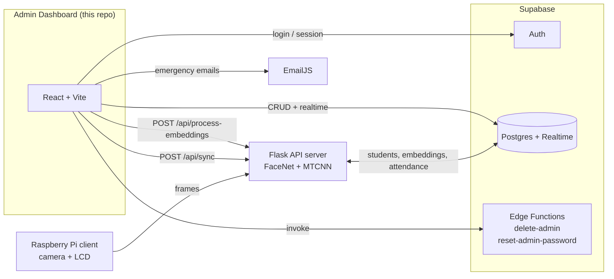

# SeNT — Secure Entry, Notification, and Tracking System

**SeNT** is a face-recognition attendance and school-safety system. This repository contains the **admin web dashboard**: a React + TypeScript app backed by Supabase. Administrators use it to register students with face photos, review and export attendance logs, and send emergency email alerts to parents.

SeNT was presented at the **STI College Munoz-EDSA School Expo 2026** and served as the primary research system for our **Practical Research 2** study.

---

## Table of Contents

- [Overview](#overview)
- [Key Features](#key-features)
- [System Architecture](#system-architecture)
- [Technology Stack](#technology-stack)
- [Project Structure](#project-structure)
- [Prerequisites](#prerequisites)
- [Installation](#installation)
- [Configuration](#configuration)
- [Database Setup](#database-setup)
- [Running the App](#running-the-app)
- [Usage Guide](#usage-guide)
- [Database Schema](#database-schema)
- [Troubleshooting](#troubleshooting)
- [Known Limitations](#known-limitations)
- [Future Improvements](#future-improvements)

---

## Overview

SeNT has three parts. **Only the web dashboard lives in this repository.**

| Component | Role | Location |
| --- | --- | --- |
| **Web dashboard** | Admin UI for students, attendance logs, emergency alerts, and admin accounts | **This repo** |
| **Flask API server** | Face detection/embedding (FaceNet + MTCNN), matching, and syncing student data | Separate project |
| **Raspberry Pi client** | Captures camera frames at the school entrance and shows results on a Waveshare HDMI LCD | Separate project |

The flow:

1. An admin registers a student in the dashboard, uploading up to four face photos (front, low angle, left, right).
2. The admin clicks **Process Images**. The dashboard asks the Flask server to generate face embeddings for every student.
3. The admin clicks **Sync**. The Flask server pulls the latest student data and embeddings so the entrance device can match against it.
4. At the entrance, the Raspberry Pi captures a face and sends it to the Flask server. A match writes a row to `attendance_logs` in Supabase.
5. The dashboard shows that new log in real time, and admins can filter it and export it to CSV or PDF.

---

## Key Features

### Student Management
- Create, edit, delete, and search students, with filters by **grade level (Grade 7–12)** and **section**.
- Stores the parent contact number and parent email for each student.
- Takes up to **four face photos per student**: front, low angle, left, and right.
- **Client-side image quality checks** before a photo is accepted:
  - JPEG or PNG only, at most **10 MB**
  - At least **200 × 200 px**
  - **Blur detection** using Laplacian variance (photos scoring below `100` are rejected)
- Shows previews cropped to 4:5 (600 × 750).
- **Process Images** and **Sync** buttons call the Flask server.
- Real-time updates through Supabase Realtime.

### Attendance Logs
- **Daily / Weekly / Monthly** tabs, plus a date picker for a specific day.
- Search by name and filter by grade and section.
- **Export to CSV** (opens in Excel) or **PDF** (via `jspdf` + `jspdf-autotable`). The PDF lists the filters that were applied.
- Updates live when new check-ins arrive.

### Emergency Alerts
- Write a custom message or choose a preset (evacuation, lockdown, severe weather, medical emergency, water or power interruption).
- Sends the message by **EmailJS** to every student's `parent_email`, after a confirmation prompt.
- Records each broadcast in `emergency_notifications` with its recipient count and shows the history in the dashboard.

### Admin Accounts
- Email/password login with Supabase Auth. Sessions persist and protected routes redirect signed-out users to `/login`.
- **Add Admin** page: create, list, and delete admin accounts, and reset their passwords. Deletion and password resets run through Supabase Edge Functions that use the service-role key.
- A built-in secure password generator.

### UI
- Animated splash screen (`/`) that redirects to `/dashboard` or `/login` depending on the session.
- Responsive layout with a collapsible sidebar and a mobile menu.
- Built with shadcn/ui (Radix UI) components, Tailwind CSS, and Framer Motion transitions.

---

## System Architecture



### Routing

| Route | Access | Component |
| --- | --- | --- |
| `/` | Public | `SplashScreen`: waits about 3.5 s, then redirects |
| `/login` | Signed-out only | `LoginForm` |
| `/signup` | Signed-out only | `SignUpForm` (not linked from the UI) |
| `/dashboard` | Signed-in only | Dashboard with sidebar views |
| `/success` | Public | `Success` page |

The dashboard views (**Student Management**, **Attendance Logs**, **Emergency Alerts**, **Add Admin**) are switched in-page from the sidebar and lazy-loaded with `React.lazy`.

### External API calls (Flask server)

| Dashboard action | Request |
| --- | --- |
| Process Images | `POST ${VITE_LOCAL_API_URL}/api/process-embeddings` and expects `{ "processed": number }` |
| Sync | `POST ${VITE_LOCAL_SYNC_API_URL}/api/sync` and expects `{ "synced": number }` |

---

## Technology Stack

| Layer | Technology |
| --- | --- |
| Framework | React 18, TypeScript 5 |
| Build tool | Vite 5 with `@vitejs/plugin-react-swc` |
| Routing | React Router 6 |
| Styling | Tailwind CSS 3, `tailwindcss-animate`, shadcn/ui (Radix UI primitives) |
| Animation | Framer Motion |
| Forms and validation | React Hook Form, Zod |
| Backend | Supabase (Auth, Postgres, Realtime, Edge Functions on Deno) |
| Email | EmailJS (`@emailjs/browser`) |
| Reporting | jsPDF, jspdf-autotable, date-fns |
| Icons | lucide-react, @radix-ui/react-icons |

**Outside this repo:** Python Flask server (FaceNet, MTCNN, NumPy, OpenCV) and a Raspberry Pi client (OpenCV, Requests, Waveshare HDMI LCD).

---

## Project Structure

```
SeNT-System/
├── index.html                  # Vite entry HTML
├── package.json                # Scripts and dependencies
├── vite.config.ts              # Vite config ("@" alias -> ./src, VITE_BASE_PATH)
├── tailwind.config.js          # Tailwind theme
├── components.json             # shadcn/ui config
├── public/                     # Static assets (logo, splash, banners)
├── src/
│   ├── main.tsx                # React root: AuthProvider + BrowserRouter
│   ├── App.tsx                 # Routes and protected/public route guards
│   ├── index.css               # Tailwind layers and CSS variables
│   ├── components/
│   │   ├── auth/               # LoginForm, SignUpForm, AuthLayout
│   │   ├── dashboard/
│   │   │   ├── StudentManagement.tsx      # Student CRUD, photo upload, blur check, Flask calls
│   │   │   ├── AttendanceLogs.tsx         # Log viewer, filters, CSV/PDF export
│   │   │   ├── EmergencyNotification.tsx  # EmailJS broadcast and history
│   │   │   ├── AddAdmin.tsx               # Admin create/delete/password reset
│   │   │   └── layout/                    # Sidebar, TopNavigation
│   │   ├── pages/              # SplashScreen, dashboard, success
│   │   └── ui/                 # shadcn/ui components
│   ├── lib/utils.ts            # cn() class-name helper
│   ├── utils/auth.ts           # Admin check, password reset call, password generator
│   ├── types/supabase.ts       # Generated Supabase types
│   └── stories/                # Component stories (from the Tempo template)
└── supabase/
    ├── supabase.ts             # Supabase client (reads VITE_SUPABASE_* env vars)
    ├── auth.tsx                # AuthProvider / useAuth hook
    ├── config.toml             # Supabase CLI local config
    ├── migrations/             # SQL schema, RLS policies, realtime setup
    └── functions/
        ├── delete-admin/            # Deletes an admin from auth.users and public.users
        └── reset-admin-password/    # Verifies the caller, then sets a new password
```

---

## Prerequisites

- **Node.js 18+** and **npm** (tested with Node 24 / npm 11)
- A **Supabase** project (free tier is enough)
- **Supabase CLI** (optional, but needed to push migrations and deploy Edge Functions)
- An **EmailJS** account with an email service and template (for emergency alerts)
- The **SeNT Flask server** running and reachable (for Process Images and Sync)

---

## Installation

```bash
git clone git@github.com:germanica-1/SeNT-System.git
cd SeNT-System
npm install
```

---

## Configuration

Create a `.env.local` file in the project root. `.env*` and `*.local` files are git-ignored.

```env
# Supabase (Project Settings -> API)
VITE_SUPABASE_URL=https://<project-ref>.supabase.co
VITE_SUPABASE_ANON_KEY=<anon-public-key>

# Flask server endpoints (no trailing slash)
VITE_LOCAL_API_URL=http://127.0.0.1:5000
VITE_LOCAL_SYNC_API_URL=http://127.0.0.1:5000

# EmailJS (Account -> API Keys, Email Services, Email Templates)
VITE_EMAILJS_PUBLIC_KEY=<public-key>
VITE_EMAILJS_SERVICE_ID=<service-id>
VITE_EMAILJS_TEMPLATE_ID=<template-id>

# Optional: base path when deploying under a sub-directory (production builds only)
# VITE_BASE_PATH=/sent/
```

| Variable | Required | Used in |
| --- | --- | --- |
| `VITE_SUPABASE_URL` | Yes (app throws on startup without it) | `supabase/supabase.ts` |
| `VITE_SUPABASE_ANON_KEY` | Yes | `supabase/supabase.ts` |
| `VITE_LOCAL_API_URL` | For Process Images | `StudentManagement.tsx` |
| `VITE_LOCAL_SYNC_API_URL` | For Sync | `StudentManagement.tsx` |
| `VITE_EMAILJS_PUBLIC_KEY` | For emergency alerts | `EmergencyNotification.tsx` |
| `VITE_EMAILJS_SERVICE_ID` | For emergency alerts | `EmergencyNotification.tsx` |
| `VITE_EMAILJS_TEMPLATE_ID` | For emergency alerts | `EmergencyNotification.tsx` |
| `VITE_BASE_PATH` | No | `vite.config.ts` |

### EmailJS template

The dashboard sends these template variables, so use them in your EmailJS template:

| Variable | Value |
| --- | --- |
| `{{to_email}}` | Parent's email (set it as the template's **To** field) |
| `{{title}}` | `EMERGENCY ALERT - STI College Munoz-EDSA` |
| `{{student_name}}` | Student's full name |
| `{{message}}` | The alert message |
| `{{from_name}}` | `STI College Munoz-EDSA Administration` |

---

## Database Setup

### 1. Create the `users` table and auth triggers

Run `supabase/migrations/initial-setup.sql` **first**, in the Supabase **SQL Editor**. It creates `public.users` and the triggers that mirror `auth.users` into it. The file has no timestamp prefix, so `supabase db push` skips it.

### 2. Apply the timestamped migrations

With the Supabase CLI:

```bash
npx supabase login
npx supabase link --project-ref <project-ref>
npx supabase db push
```

You can also paste each `supabase/migrations/2024*.sql` file into the SQL Editor **in filename order**.

> ⚠️ `20241223000011_update_attendance_logs_structure.sql` **drops and recreates** `attendance_logs`. Do not re-run it against a database with logs you want to keep.

### 3. Deploy the Edge Functions

The dashboard invokes the functions by these slugs:

| Client invokes | Source folder |
| --- | --- |
| `supabase-functions-delete-admin` | `supabase/functions/delete-admin/` |
| `supabase-functions-reset-admin-password` | `supabase/functions/reset-admin-password/` |

`supabase functions deploy <name>` uses the folder name as the slug, so deploy each function under the slug the client expects. For example, copy each folder to the expected name before deploying:

```bash
cp -r supabase/functions/delete-admin supabase/functions/supabase-functions-delete-admin
cp -r supabase/functions/reset-admin-password supabase/functions/supabase-functions-reset-admin-password
npx supabase functions deploy supabase-functions-delete-admin
npx supabase functions deploy supabase-functions-reset-admin-password
```

The functions read `SUPABASE_URL`, `SUPABASE_ANON_KEY`, and `SUPABASE_SERVICE_ROLE_KEY`. Hosted Supabase provides these automatically.

### 4. Create the first admin

Open `http://localhost:5173/signup` and register (the page is not linked from the login screen), or add a user under **Authentication -> Users** in the Supabase dashboard. After that, manage admins from the **Add Admin** page.

### 5. (Optional) Regenerate types

```bash
SUPABASE_PROJECT_ID=<project-ref> npm run types:supabase
```

---

## Running the App

| Command | Description |
| --- | --- |
| `npm run dev` | Start the Vite dev server at `http://localhost:5173` |
| `npm run build` | Type-check with `tsc`, then build to `dist/` |
| `npm run preview` | Serve the production build locally |
| `npm run types:supabase` | Regenerate `src/types/supabase.ts` (needs `SUPABASE_PROJECT_ID`) |

```bash
npm run dev
```

> `npm run lint` is defined in `package.json`, but ESLint is not installed as a dependency, so it fails unless you add ESLint and a config.

---

## Usage Guide

1. **Sign in** at `/login`. The splash screen at `/` sends you there automatically.
2. **Student Management** -> **Add Student**: enter name, grade, section, parent contact, and parent email (all required), then upload the face photos.
3. Click **Process Images** to have the Flask server generate face embeddings.
4. Click **Sync** to push the updated student data to the recognition system.
5. **Attendance Logs**: choose Daily / Weekly / Monthly or a specific date, filter, then **Export** to CSV or PDF.
6. **Emergency Alerts**: choose or write a message, confirm, and every parent email on file receives it.
7. **Add Admin**: create, delete, or reset the password of admin accounts.

---

## Database Schema

Final shape after all migrations. Tables used by the dashboard:

**`students`**

| Column | Type | Notes |
| --- | --- | --- |
| `id` | `uuid` | Primary key |
| `full_name`, `grade_level`, `section` | `varchar` | Required |
| `parent_contact` | `varchar(20)` | Required |
| `parent_email` | `varchar(255)` | Recipient for emergency alerts |
| `face_image_{front,low_angle,left,right}_url` | `text` | Photo stored as a **base64 data URL** |
| `face_embedding_{front,low_angle,left,right}` | `float8[128]` | Filled in by the Flask server |
| `created_at`, `updated_at` | `timestamptz` | |

**`attendance_logs`**: `id`, `full_name`, `grade_level`, `section`, `time` (`time`), `date` (`date`), `created_at`. Indexed on `date`, `(grade_level, section)`, and `full_name`. Rows are written by the recognition system. The dashboard only reads them.

**`emergency_notifications`**: `id`, `message`, `sent_at`, `sent_by`, `recipient_count`.

**`users`**: admin profiles mirrored from `auth.users` (`id`, `email`, `full_name`, ...).

Also created but **not used by the current UI**: `school_settings`, `grade_level_schedules` (from an earlier dismissal-notification feature).

Row Level Security is enabled on every table, and policies give **any authenticated user** full access. Realtime is enabled for `students`, `attendance_logs`, `emergency_notifications`, `users`, `school_settings`, and `grade_level_schedules`.

---

## Troubleshooting

| Problem | Likely cause and fix |
| --- | --- |
| Blank page with `Missing Supabase environment variables` in the console | `.env.local` is missing `VITE_SUPABASE_URL` / `VITE_SUPABASE_ANON_KEY`. Add them and **restart** `npm run dev`, because Vite reads env vars only at startup. |
| "Failed to process embeddings" or "Failed to sync students" | The Flask server is not running, the URL in `VITE_LOCAL_API_URL` / `VITE_LOCAL_SYNC_API_URL` is wrong (check for a trailing slash), or the server is blocking the dashboard's origin with CORS. |
| Photo rejected with "Image appears to be blurry" | Laplacian variance is below `100`. Retake with better focus and lighting. |
| Photo rejected for resolution, type, or size | Photos must be JPEG/PNG, at least 200 × 200 px, and at most 10 MB. |
| Emergency alert sends 0 emails | Check the three `VITE_EMAILJS_*` values, that the template's **To** field is `{{to_email}}`, and your EmailJS monthly quota. Students without `parent_email` are skipped. |
| A parent receives the same alert more than once | Alerts are sent once **per student**, so a parent with several enrolled children receives one email per child. |
| Deleting an admin or resetting a password fails | The Edge Functions are not deployed under the slugs the client calls. See [Deploy the Edge Functions](#3-deploy-the-edge-functions). |
| Attendance Logs is empty | Logs come from the recognition system, not the dashboard. Also check the tab: **Daily** uses the browser's local date. |
| `npm run build` prints TypeScript errors but still produces `dist/` | The script is `tsc ; vite build`, so `vite build` runs even when `tsc` reports errors. The current codebase has a few non-blocking type errors. |
| Signing out lands on the wrong URL when deployed under a sub-path | Sign-out redirects with `window.location.href = "/login"`, which ignores `VITE_BASE_PATH`. Deploy at the domain root, or adjust that redirect. |
| "Chunk larger than 500 kB" warning during build | Expected (PDF export libraries). It is only a warning. |

---

## Known Limitations

- **Face photos are stored as base64 in the `students` table**, not in Supabase Storage. This makes rows large and slows down queries.
- **The `/signup` route is publicly reachable**, so anyone who knows the URL can create an admin account.
- **The `delete-admin` Edge Function does not verify the caller.** `reset-admin-password` does check that the caller is an authenticated admin.
- **RLS policies make no distinction between roles.** Every authenticated user has full read and write access.
- **"Export to Excel" produces a CSV file**, not `.xlsx`.
- Leftover template code that is not wired into the app: `DashboardGrid.tsx` (imported but not rendered), `TaskBoard.tsx`, `pages/home.tsx`, `SchoolScheduleSettings.tsx` (stub), `AttendanceManagementStoryboard.tsx`, `src/stories/`, the `process-embeddings` and `scheduled-dismissal-notifications` function stubs, the `face-api.js` dependency, and the `tempo-devtools` integration.

---

## Future Improvements

- Move face photos to **Supabase Storage** and keep only URLs in the database.
- Remove or protect the public `/signup` route, and add an authorization check to `delete-admin`.
- Add **role-based access control** (for example super-admin vs. staff) to the RLS policies.
- Send emergency alerts through a server-side function, so EmailJS keys are not exposed in the browser and each parent gets one email.
- Add **check-in notifications to parents** and **automatic dismissal alerts** to the dashboard (the schema already has `school_settings` and `grade_level_schedules`).
- Add an attendance analytics view (daily counts, late arrivals, absences).
- Native `.xlsx` export.
- Install ESLint, fix the remaining TypeScript errors, and make `npm run build` fail on type errors (`tsc && vite build`).
- Remove unused template files and dependencies.
- Add a `.env.example` file.

---

## Acknowledgments

Developed by students of **STI College Munoz-EDSA** for the **School Expo 2026** and as the research system for **Practical Research 2**.
